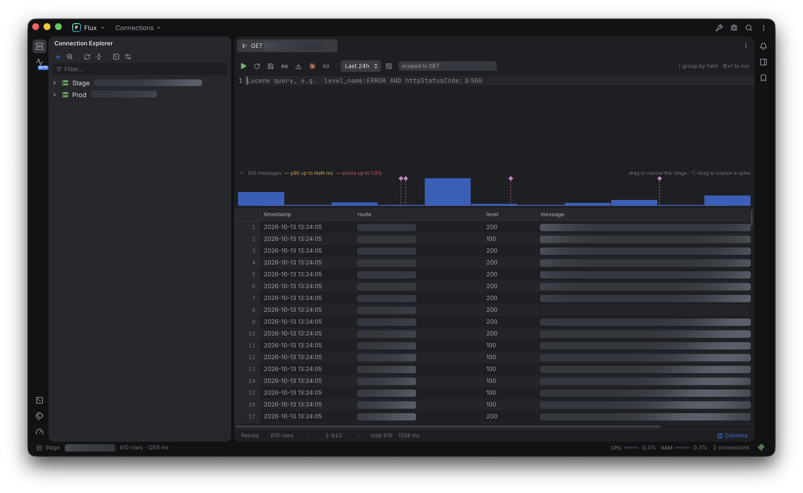

<div align="center">


# Flux

**The modern log explorer.**

Navigate your logs by structure instead of retyping filters.



</div>

---

## Why

A search box treats logs as one flat river of text. You type a query, read the answer,
and the tool forgets everything the moment you look somewhere else. The structure that
actually matters, which service, which stream, which endpoint, survives only as strings
you retype.

Flux keeps that structure. Streams and endpoints are objects you navigate to. Each one
opens its own console and result grid, and each stays open while you work elsewhere, so
comparing two endpoints is two tabs rather than two rounds of editing a filter.

## What it does

- **Explorer tree** — `Connection › Project › Stream › Endpoint`, loaded lazily.
  Endpoint rows carry their request count and error rate.
- **Query console** — Lucene with syntax colouring and completion over the stream's
  own field names. `⌘⏎` runs it.
- **Result grid** — virtualised, sortable, resizable columns, a row-number gutter,
  and severity colouring on level and status cells.
- **Value inspector** — the selected row as syntax-coloured JSON, with strings that
  contain JSON expanded into real structure.
- **Search Everywhere** — `⇧⇧` to jump to any stream, endpoint, project or action.
- **Workspaces** — open a folder and Flux keeps that folder's stream grouping and layout
  in a `.flux` directory inside it, the way an IDE keeps `.idea`.
- **MCP server** — while Flux is open, an agent in your terminal can read the same logs
  through the same connections: connections, streams, searches, counts and endpoints, as
  JSON. Loopback only, behind a token, read-only.
- **Settings** — ten pages covering appearance, the tree, the console, the grid, the
  terminal, updates, the workspace, connections, the keymap and advanced network options.

## Install

Download the latest `.dmg` from the
[releases](https://github.com/bozkurtemre/flux/releases), drag Flux to `/Applications`, and
clear the quarantine flag before opening it:

```sh
xattr -dr com.apple.quarantine /Applications/Flux.app
```

Flux is not signed with an Apple Developer ID, so macOS quarantines it as a browser download
and offers nothing but "Move to Trash" — the flag is what that refusal is about, and `-r`
matters because it is written through the bundle. This is a one-time step per manual
install: updates that Flux downloads itself never carry the flag.

### From source

Requires [Node 24+](https://nodejs.org), [pnpm 11+](https://pnpm.io) and a
[Rust toolchain](https://rustup.rs).

```sh
make install     # dependencies
make hooks       # install the pre-commit quality gate
make dev         # run with hot reload
make app         # build Flux.app
```

`make` on its own lists every target.

## First run

Open **Settings › Connections** (`⌘,`) and add a Graylog URL with an access token from
_Graylog profile › Edit tokens_. That is the whole setup; Flux talks to Graylog and
nothing else.

**Settings › Projects** is optional. Group a connection's streams into the services they
belong to and the tree grows a third level, `Connection › Project › Stream › Endpoint`.
Skip it and streams sit directly under the connection.

## Shortcuts

| Key       | Action                                |
| --------- | ------------------------------------- |
| `⇧⇧`      | Search Everywhere                     |
| `⇧⌘O`     | Go to Endpoint                        |
| `⌘⏎`      | Execute the query                     |
| `⌘W`      | Close the tab                         |
| `⌘,`      | Settings                              |
| `↑ ↓ → ←` | Move, expand and collapse in the tree |
| `↵`       | Open the selected stream or endpoint  |

## How it is built

Tauri v2 (Rust) with a React 19 front end in TypeScript, bundled by Vite and styled
with Tailwind v4. Dark and light themes, both built for long sessions: low-chroma
surfaces, panels that float as rounded islands, Inter for the interface and JetBrains
Mono for everything that holds data.

Three details are worth knowing before changing anything:

- **Graylog calls go through `@tauri-apps/plugin-http`**, so they are issued from Rust.
  There is no CORS preflight and no proxy server to run.
- **The tree is served from a cache, not from Graylog.** Expanding a stream reads the
  endpoint list off disk and shows it immediately; Refresh is what re-reads the source.
  The cache lives in the OS cache directory and is safe to delete at any time, which is
  what makes **Settings › Advanced › Invalidate Caches** a supported operation rather
  than a repair. Bumping `FORMAT` in `src/lib/cache.ts` discards every entry.
- **Endpoints are templates, not paths.** `/users/123` and `/users/456` are one endpoint,
  `/users/:id`. The collapsing happens per path segment, never on a substring; see
  `src/lib/normalize.ts` and the tests beside it for why that distinction matters.

Traffic figures come from two aggregations per stream: one grouped by route and method for
totals and the 95th percentile, one under a `status:>=500` filter for the error counts.
Grouping route by method by status in a single query multiplies into hundreds of thousands
of buckets on a busy stream and times out.

```
src/
  lib/graylog.ts          Graylog 5.2 client: search, aggregate, streams, fields
  lib/endpoints.ts        endpoint rows derived from two aggregations
  lib/normalize.ts        path segments to endpoint templates
  lib/cache.ts            the introspection cache, keyed by connection
  lib/settings.ts         the settings model, persisted with the store plugin
  store.ts                tree, tabs and query state (zustand)
  components/             one file per region of the window
  components/settings/    the Settings window and its pages
src-tauri/src/cache.rs    reads and writes the OS cache directory
```

## Where your data lives

Three tiers, split by what happens if a file is lost.

| What                 | Where              | Lost if deleted                                          |
| -------------------- | ------------------ | -------------------------------------------------------- |
| `connections.json`   | config directory   | your Graylog URLs **and their access tokens**            |
| `projects.json`      | config directory   | how streams are grouped; worth sharing with a team       |
| `preferences.json`   | config directory   | how you like the window                                  |
| `session.json`       | config directory   | which tabs and branches were open with no workspace open |
| `queries.json`       | config directory   | the queries you kept with no workspace open              |
| `.window-state.json` | config directory   | the size and place of the window                         |
| `<folder>/.flux/`    | the workspace      | that folder's stream grouping, saved queries and session |
| Introspection cache  | OS cache directory | nothing, it is re-read from Graylog                      |

`connections.json` holds access tokens in the clear, so treat it as a credential: do not
commit it, share it or put it anywhere that syncs. It is deliberately the one thing a
workspace does not carry — a `.flux` directory usually sits in a git checkout, and a token
there is one forgotten `.gitignore` line from being published. The cache directory is safe to
delete at any time.

## Development

```sh
make check    # typecheck, eslint, prettier and clippy, exactly what CI runs
make fmt      # format TypeScript and Rust in place
```

`make hooks` points git at `.githooks`, so the same gate runs over your staged files
before every commit. It is the same set of checks CI runs, scoped to what changed, so
a commit that passes locally passes on the server. `git commit --no-verify` skips it
when you genuinely need to, but CI will still fail.

CI runs the full gate on every pull request and bundles the app on pushes to `main`. That
bundle is a test artifact and stays unsigned.

## Releasing

The version lives in four files. One command keeps them in step, runs the quality gate,
commits and tags:

```sh
make version       # what is the current version
make bump-patch    # 0.1.0 -> 0.1.1, commit and tag
make publish       # push the branch and the tag
```

Pushing a `v*` tag runs the release workflow, which re-runs the quality gate, builds
`Flux.app` and a `.dmg`, and publishes them as a GitHub Release with generated notes.
The workflow refuses a tag that disagrees with the version in the tree, so the tag and
the binary can never describe different builds.

When the workflow cannot run — GitHub refusing to start it, as it does when an account's
Actions billing lapses — the same release can be made from this machine:

```sh
make bump-minor     # as before: commit and tag
make release-local  # push, check, build, publish to R2, prune, and make the GitHub release
```

It does what the workflow does, in the same order, with the keys the workflow holds as
secrets read from a folder outside the repository — `~/Desktop/flux-updater-keys` unless
`KEYS=` says otherwise — holding `flux.key`, `password.txt` and an `r2.env` that sets
`R2_ACCOUNT_ID`, `R2_ACCESS_KEY_ID`, `R2_SECRET_ACCESS_KEY` and `BUCKET`. It refuses to
release anything but the commit the version was tagged at, and running it twice for the same
version publishes the same files again.

Changes are recorded in [CHANGELOG.md](CHANGELOG.md).

## Security

Access tokens are stored in `connections.json`, in the clear, next to the URL they belong
to. They were kept in the operating system's credential store until 0.5.0; the Keychain
asks permission of whichever binary is asking, and an unsigned update is a different binary
every time, so the choice was between a prompt after every update and a file you have to
look after. The reasoning is in [docs/adr/0005](docs/adr/0005-the-token-lives-in-the-settings-file.md).

Protect that file the way you would an SSH key: it is readable by anything that can read
your home directory, and it travels with any backup or sync that includes the config
directory. Deleting a connection removes its token from the file.

Tokens are sent nowhere except the Graylog instance they belong to. Flux only ever reads:
it issues searches and aggregations, and never writes to Graylog.

## Licence

MIT, see [LICENSE](LICENSE).
